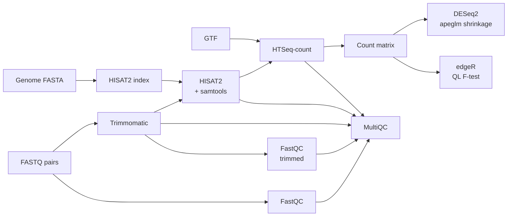

# RNA-seq Differential Expression Pipeline

[](https://github.com/kashyapshilpi/RNA-Seq-DEGs-analysis/actions/workflows/ci.yml)
[](https://www.nextflow.io/)
[](https://docs.conda.io/)
[](https://www.docker.com/)

A Nextflow (DSL2) pipeline for paired-end RNA-seq: from raw reads to differentially expressed genes, with **DESeq2** as the primary method and **edgeR** as an independent cross-check. Every push is tested end-to-end on public data by GitHub Actions.

## Workflow



## Quick start

Requires [Nextflow](https://www.nextflow.io/docs/latest/install.html) ≥ 24.04 and either conda or Docker.

Try it on the bundled public test data (yeast, from nf-core/test-datasets):

```bash
nextflow run kashyapshilpi/RNA-Seq-DEGs-analysis -profile test,docker
# or
nextflow run kashyapshilpi/RNA-Seq-DEGs-analysis -profile test,conda
```

Run on your own data:

```bash
nextflow run kashyapshilpi/RNA-Seq-DEGs-analysis -profile docker \
    --input samplesheet.csv \
    --fasta genome.fa \
    --gtf genes.gtf \
    --strandedness reverse \
    --outdir results
```

## Samplesheet

```csv
sample,fastq_1,fastq_2,condition
CTRL_1,/data/ctrl1_R1.fastq.gz,/data/ctrl1_R2.fastq.gz,control
CTRL_2,/data/ctrl2_R1.fastq.gz,/data/ctrl2_R2.fastq.gz,control
TREAT_1,/data/trt1_R1.fastq.gz,/data/trt1_R2.fastq.gz,treatment
TREAT_2,/data/trt2_R1.fastq.gz,/data/trt2_R2.fastq.gz,treatment
```

Paths can be local files or URLs. See [`assets/samplesheet_test.csv`](assets/samplesheet_test.csv).

## Parameters

| Parameter | Default | Description |
|---|---|---|
| `--input` | – | Samplesheet CSV (required) |
| `--fasta` | – | Reference genome FASTA (required) |
| `--gtf` | – | Gene annotation GTF (required) |
| `--outdir` | `results` | Output directory |
| `--strandedness` | `no` | HTSeq strandedness: `no`, `yes` or `reverse` (most TruSeq stranded kits are `reverse`) |
| `--gtf_attribute` | `gene_id` | GTF attribute used as the gene ID |
| `--contrast_reference` | `control` | Reference condition |
| `--contrast_target` | `treatment` | Condition compared against the reference |
| `--padj` | `0.05` | Adjusted p-value / FDR cutoff |
| `--lfc` | `1` | Absolute log2 fold-change cutoff |
| `--min_len` | `36` | Minimum read length after trimming |
| `--adapters` | TruSeq3-PE | Adapter FASTA for Trimmomatic |

## Profiles

| Profile | What it does |
|---|---|
| `conda` / `mamba` | Creates a conda environment per step from bioconda / conda-forge |
| `docker` | Runs each step in a container built from the same conda packages via [Wave](https://seqera.io/wave/) |
| `test` | Small public dataset for a quick end-to-end check |

## Outputs

| Folder | Contents |
|---|---|
| `fastqc_raw/`, `fastqc_trimmed/` | Per-sample read QC |
| `trimmomatic/` | Trimmed read pairs and logs |
| `hisat2_align/` | Sorted, indexed BAMs and alignment summaries |
| `htseq_count/` | Per-sample gene counts |
| `merge_counts/count_matrix.tsv` | Gene × sample count matrix |
| `deseq2/` | `DEGs.tsv`, `DEGs_up.tsv`, `DEGs_down.tsv`, `all_genes.tsv`, normalised counts, dispersion / MA / PCA / distance heatmap / volcano plots |
| `edger/` | Same tables plus MDS, BCV, QL dispersion and volcano plots |
| `multiqc/multiqc_report.html` | Combined QC report |
| `pipeline_info/` | Nextflow execution report, timeline and trace |

## Repository layout

```
main.nf              workflow
nextflow.config      parameters, resources, profiles
modules/             one process per tool
bin/                 R and Python scripts used by the pipeline
conf/test.config     public test dataset
assets/              test samplesheet, adapter sequences
.github/workflows/   CI: stub run + end-to-end conda test
```

## Background

Started as my MSc training project on differential expression (originally a tea-plant RNA-seq dataset) and rebuilt as a reproducible, tested Nextflow pipeline.

## License

MIT. See [licence.txt](licence.txt).
